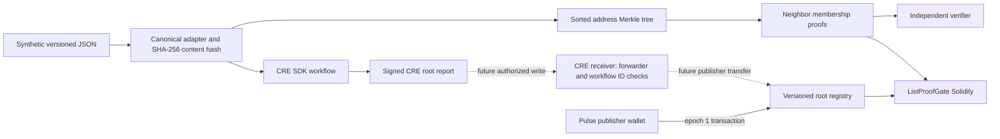

# ListProof

ListProof is a hackathon prototype for proving that an EVM address is absent from **one committed, versioned address set**. It is a technical demonstration, not sanctions compliance, legal approval, KYC, or identity verification. The default dataset contains only synthetic addresses.

**Current state (2026-10-30):** Registry [`0x1607…4Efa`](https://sepolia.etherscan.io/address/0x1607Af4E1DA1C06362871443d2e95C367B984Efa) and Gate [`0xf88F…A9A3`](https://sepolia.etherscan.io/address/0xf88F9870fe6e135d5bD56852750c8af8a466A9A3) are deployed on Sepolia. Synthetic epoch 1 was published in [transaction `0x824c…478d`](https://sepolia.etherscan.io/tx/0x824c1f5a44aff746f8737b9e97d6e92d5e42a23a69d4627b6a8fe7de8e7d478d); local receipt evidence verifies calldata, event, runtime bytecode and contract state. The official CRE local simulation prepared a report but did **not** read the Registry or send a transaction. Current Gate `eth_call` proof checks and CRE Registry-read simulation await runs from an unrestricted PowerShell. No live DON workflow, public GitHub repository or public demo is verified.

## Quick start on Windows PowerShell

```powershell
cd C:\Users\Win10_Game_OS\Pulse\projects\listproof
node --version  # Node 20+
npm.cmd run check
npm.cmd run demo
npm.cmd run serve
# In another PowerShell window:
npm.cmd run preflight
npm.cmd run capture
```

Open `http://127.0.0.1:4173`. The UI has four local proof scenarios and a separate Sepolia evidence panel. Its proof buttons do not make a blockchain transaction or call the Gate.

## Architecture



The CRE workflow uses a cron trigger, HTTP capability with identical aggregation, pinned content hash, schema/version/root checks, and a Sepolia block read. The [saved official local simulation](evidence/cre-local-simulation.txt) completed these operations and prepared a report. Its config had no Registry or receiver, so it made no contract read or write. A new `audit-current` target is configured to read the deployed Registry's epoch/root/dataset ID/content hash/count at a finalized block and prepare a read-only report; its official simulation is **not yet captured**. The receiver contract enforces forwarder and workflow ID, but no receiver has been deployed and no CRE on-chain write is claimed.

## Proof format and verification

- Normalize an EVM address as exactly `0x` plus 40 hexadecimal characters, lowercased. Mixed case is accepted as input; EIP-55 checksum is not enforced.
- `datasetKey = SHA256(UTF8(datasetId))`.
- `leaf = SHA256(0x00 || uint256(chainId) || datasetKey || uint256(epoch) || address20)`.
- `parent = SHA256(0x01 || left32 || right32)`. The address list is lexicographically sorted. At odd levels, the final node is promoted unchanged.
- A membership witness contains address, zero-based index and ordered siblings. Verification recomputes expected sibling positions from index and committed leaf count. Extra, absent, malformed or swapped siblings fail.
- A non-membership witness contains both adjacent members when in the interior, or the sole first/last member at a boundary. It verifies their membership, address ordering, and adjacency. Empty sets are rejected.
- The verifier checks chain ID, dataset ID and its key, scheme, epoch, root and count against a trusted commitment. The Solidity gate reads the current root, count and epoch from its registry and uses `block.chainid`.

The proof generator is not part of the trust boundary: [src/verify.mjs](src/verify.mjs) independently parses and hashes the witness. The verifier still relies on SHA-256 collision resistance, the trusted commitment, a correct dataset publisher, and accurate source data. A publisher could omit a listed address; the proof cannot detect that. Reorgs, revocations, dataset freshness, identity linkage, and cross-chain portability are outside this MVP.

## Data and provenance

`data/epoch-1.json` and `data/epoch-2.json` are pinned synthetic fixtures. The adapter serves minified JSON; SHA-256 content hashes are pinned in the CRE config. `data/invalid-schema.json` is a negative-test fixture. The UI returns a downloadable local receipt containing the commitment, proof, content hash and independent verification result; it is **not a blockchain receipt or signature**. No OFAC record is represented as an EVM wallet. A future real dataset requires explicit license, source URL, acquisition timestamp, address extraction policy, review, and versioning. A non-membership proof says nothing about addresses outside the selected dataset.

Download a receipt from the UI, then verify it without the server using a root and epoch obtained from a trusted commitment:

```powershell
node scripts/verify-receipt.mjs .\receipt.json --root 0xd5a80d20b41a1049e2a75edbc04761063113ea3002b8f575c4993284b8ab5888 --epoch 1
```

The example root is the synthetic epoch-1 fixture. A root copied only from the same untrusted receipt is not an independent trust anchor.

## Solidity and CRE verification

```powershell
# With an available Docker Engine:
docker run --rm --entrypoint forge -v "${PWD}:/app" -w /app ghcr.io/foundry-rs/foundry:stable build
docker run --rm --entrypoint forge -v "${PWD}:/app" -w /app ghcr.io/foundry-rs/foundry:stable test -vvv

# Read-only Sepolia Gate checks; no wallet or transaction:
npm.cmd run onchain:proofs
npm.cmd run public:evidence

# The owner environment has Bun and authenticated CRE CLI installed.
cd cre\listproof
bun run typecheck
cd ..
# In a second terminal, from repository root: npm.cmd run serve
cre workflow simulate listproof --target local-settings --non-interactive --trigger-index 0
# Actual Sepolia Registry audit; no receiver or write:
cre workflow simulate listproof --target onchain-settings --non-interactive --trigger-index 0
cre workflow simulate listproof --target onchain-stale-settings --non-interactive --trigger-index 0
# Expected failures, using pinned negative fixtures:
cre workflow simulate listproof --target bad-hash-settings --non-interactive --trigger-index 0
cre workflow simulate listproof --target bad-root-settings --non-interactive --trigger-index 0
cre workflow simulate listproof --target stale-settings --non-interactive --trigger-index 0
cre workflow simulate listproof --target invalid-schema-settings --non-interactive --trigger-index 0
cre workflow simulate listproof --target unavailable-settings --non-interactive --trigger-index 0
```

The official [Windows CRE installation guide](https://docs.chain.link/cre/getting-started/cli-installation/windows) explains account setup. Use [the CRE runbook](docs/CRE-RUNBOOK.md) to execute all targets and capture logs.

The CRE configs point at the local synthetic dataset adapter. The new on-chain audit and negative targets are prepared but have **not** been run through CRE in this Codex sandbox. A live DON write still needs a verified workflow ID, forwarder, public dataset URL and authorized registry publisher transfer; it is not part of the current deployment. See the [read-only proof runbook](docs/ONCHAIN-PROOFS.md), [CRE runbook](docs/CRE-RUNBOOK.md), and [CRE simulation docs](https://docs.chain.link/cre/guides/operations/simulating-workflows).

## Free hosting preparation

The Node server supports `PORT` and `LISTPROOF_HOST`, exposes `/api/health` and a curated public Sepolia evidence summary at `/api/sepolia`. A [Dockerfile](Dockerfile) is included; no public deployment is verified. The public image runs only the read-only demo server, without the localhost MetaMask signing interface. For a remote CRE workflow, use a public dataset URL and recheck the pinned content hash.

## Threat model

| Threat | Control | Limit |
|---|---|---|
| Forged neighbor or missing sibling | Root recomputation, index/count checks | Trusts published root |
| Proof substitution | Target ordering and adjacency | Only selected dataset |
| Stale proof | Registry current epoch/root/count | Publisher must update promptly |
| Replay transfer/evidence | Sender nonce and one-use sender/recipient/epoch/root key | Demo ledger permits one transfer to a recipient per epoch |
| Unauthorized root | Publisher check and sequential epoch | Publisher compromise remains possible |
| Ambiguous source | Pinned schema and content hash | Source accuracy is a human/process question |

## Bounty alignment and event status

The intended CRE value is to fetch a pinned external dataset, verify its content and version, compute the commitment, compare a testnet registry state, and emit an auditable update report. The [Chainlink CRE docs](https://docs.chain.link/cre/overview) say local simulation is available, while live DON deployment requires access approval. The [BLI organizer page](https://bli.foundation/hackathon/) mentions judging November 5–December 5, 2026 and awards December 12, 2026. A [BLI organizer article](https://bli.tools/international-hackathon-with-ryo-digital-chainlink-labs-focuses-on-ai-payrails-stablecoins-more/) says October 31 is the submission date; the exact DoraHacks cutoff time and specific bounty rules were not independently verified. October 31, 2026 20:00 Europe/Kyiv is an internal deadline only.

## Submission status

See the [evidence report](docs/EVIDENCE.md), [Sepolia proof runbook](docs/ONCHAIN-PROOFS.md), [CRE runbook](docs/CRE-RUNBOOK.md), [public demo guide](docs/PUBLIC-DEMO.md), [competitor review](docs/COMPETITOR-REVIEW.md), [90-second demo script](docs/DEMO.md), and [DoraHacks draft](docs/SUBMISSION.md). Explorer links for deployment and root publication exist; public GitHub, demo and video URLs, live DON evidence and Gate `eth_call` results are missing.

For owner-approved Sepolia deployments through MetaMask, use the **localhost-only** [MetaMask deployment guide](docs/METAMASK-DEPLOY.md). This interface requires a separate ethers.js install in `deploy-ui` and a separate confirmation for each transaction. No deployment is implied by its presence.
