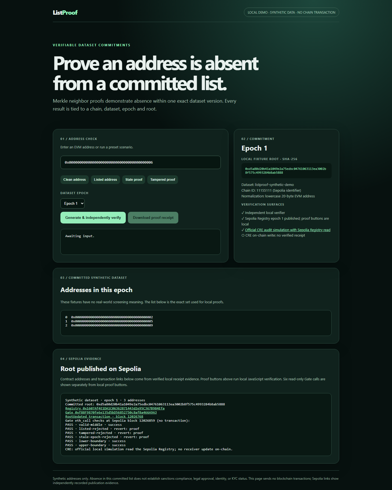
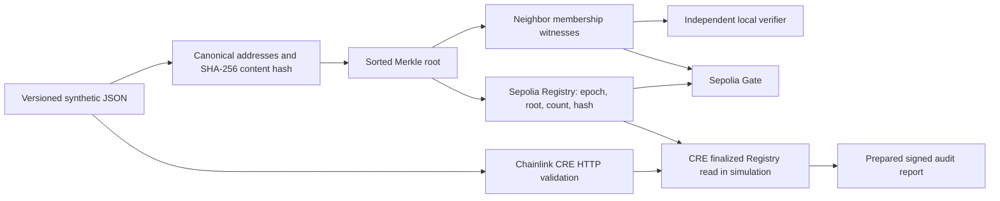

# ListProof

> **Cryptographic evidence that an EVM address is absent from one committed, versioned set.**

ListProof is a synthetic address-screening demonstration for BLI Legal Tech Hackathon 2, targeting Chainlink's **Best workflow with CRE** bounty. The claim is limited to a particular dataset and epoch. It does **not** establish sanctions compliance, legal clearance, identity, or source completeness.

**Explore:** [Registry](https://sepolia.etherscan.io/address/0x1607Af4E1DA1C06362871443d2e95C367B984Efa) · [Gate](https://sepolia.etherscan.io/address/0xf88F9870fe6e135d5bD56852750c8af8a466A9A3) · [epoch-1 transaction](https://sepolia.etherscan.io/tx/0x824c1f5a44aff746f8737b9e97d6e92d5e42a23a69d4627b6a8fe7de8e7d478d) · [evidence](docs/EVIDENCE.md) · [submission draft](docs/SUBMISSION.md).

**Demo:** run `npm.cmd run serve` and open `http://127.0.0.1:4173`. No hosted demo URL has been verified. A judge needs no wallet to use the local proof demo.



_Captured from the running local application on 2026-10-30, before clicking a proof scenario. The proof scenarios are reproducible using the commands below._

## Problem and solution

A plain “not on the list” API response does not identify the dataset, version or verifiable reason. ListProof commits a sorted synthetic list and authenticates the immediate neighbors of a queried address. A verifier checks their Merkle paths, ordering, adjacency, epoch and root. Updating the set creates a new epoch.



The [Registry](contracts/ListProof.sol) accepts sequential updates from its publisher. The Gate is a test-only ledger that checks proofs against the Registry's **current** epoch, root and count. Its transfer also checks a sender nonce and one-use sender/recipient/epoch/root evidence key. The [CRE workflow](cre/listproof/main.ts) has a cron trigger. Its saved audit simulation fetches the dataset, validates it, reads the real Sepolia Registry and prepares a report. **No live DON execution or CRE write transaction is claimed.**

## Exact proof mathematics

The implementation is [src/core.mjs](src/core.mjs), [src/verify.mjs](src/verify.mjs) and [contracts/ListProof.sol](contracts/ListProof.sol). Addresses must be `0x` plus exactly 40 hex digits, then are lowercased and sorted by their 20-byte hexadecimal value. Duplicate and empty sets fail. Mixed case input is accepted; EIP-55 checksums are not enforced.

Let $H$ be SHA-256, $\|$ byte concatenation, $U_{256}$ a 32-byte big-endian integer, and $A$ the 20 address bytes. For chain $c$, epoch $e$, and dataset key $K=H(\mathrm{UTF8}(\text{datasetId}))$:

$$L(A)=H(\texttt{0x00}\|U_{256}(c)\|K\|U_{256}(e)\|A)$$

$$P(X,Y)=H(\texttt{0x01}\|X\|Y)$$

Prefixes separate leaves and internal nodes. Adjacent nodes are hashed **in order**; an unpaired final node is promoted unchanged. A membership witness carries an address, zero-based index and bottom-up siblings. The verifier derives sibling positions from index and leaf count, rejecting extra or absent siblings.

An interior absence witness authenticates adjacent leaves $a_i<t<a_{i+1}$ and verifies both paths and index adjacency. A lower-boundary witness checks $t<a_0$ and index 0; an upper-boundary witness checks $a_{n-1}<t$ and index $n-1$. Strict inequalities reject listed addresses. The trusted commitment binds chain ID, dataset ID/key, scheme, epoch, root and count. Solidity uses `block.chainid` and current Registry state. The local proof button uses fixture state and makes **no RPC call**.

**Worked example:** epoch 1 contains synthetic addresses ending `...02`, `...05`, `...09`. Query `...06` has authenticated neighbors `...05` (index 1) and `...09` (index 2), so `05 < 06 < 09` proves absence from this three-address set. Its root is `0xd5a80d20b41a1049e2a75edbc04761063113ea3002b8f575c4993284b8ab5888`. Query `...05` is listed. Epoch 2 adds `...07`, producing `0xd85061ea6396f625770449c26ddd3d76a429bfe475f2ad7fb046e25ce529fc31`; an epoch-1 proof fails against epoch 2.

## Chainlink CRE

```mermaid
sequenceDiagram
  participant C as CRE cron
  participant H as HTTP capability
  participant W as ListProof workflow
  participant R as Sepolia Registry
  C->>W: Trigger simulation
  W->>H: Fetch pinned dataset
  H-->>W: JSON bytes
  W->>W: Check SHA-256, schema, epoch, Merkle root
  W->>R: Read finalized epoch, root, ID, hash, count
  R-->>W: Published epoch-1 state
  W->>W: Reject inconsistency
  W-->>C: Prepared signed audit report; no transaction
```

The [audit config](cre/listproof/config.onchain.json) targets the deployed Registry. [Official CLI output](evidence/cre-onchain-settings.txt) records a matching epoch-1 read of root, content hash and count, followed by `signed audit report prepared; read-only registry check; no transaction sent`. The [stale on-chain case](evidence/cre-onchain-stale-settings.txt) rejects an epoch mismatch. Other saved negative logs reject bad content hash, bad root, stale config, invalid schema and unavailable dataset. These are **official local CRE simulations**, with real reads where configured. The [older local simulation](evidence/cre-local-simulation.txt) had no Registry configured. A receiver exists in source but has not been deployed.

A live `publish-next` path needs approved DON access, a public byte-identical dataset URL, verified forwarder and workflow ID, a deployed receiver and an owner-approved publisher transfer. See the [CRE runbook](docs/CRE-RUNBOOK.md) and [Chainlink's simulation/deployment distinction](https://docs.chain.link/cre/overview).

## Evidence and tests

| Class | Verified fact | Evidence |
|---|---|---|
| **ONCHAIN_TRANSACTION** | Registry and Gate deployed; epoch 1 published in block 12026768 | [publication transaction](https://sepolia.etherscan.io/tx/0x824c1f5a44aff746f8737b9e97d6e92d5e42a23a69d4627b6a8fe7de8e7d478d), [curated summary](data/sepolia-public.json) |
| **ONCHAIN_READ** | Six Gate `eth_call` scenarios passed at saved block 12026859: valid middle and boundaries; listed, tampered and stale rejected | [curated summary](data/sepolia-public.json); original calldata/RPC report retained locally outside Git |
| **OFFICIAL_CRE_SIMULATION** | Dataset and real Registry read matched epoch 1; audit report prepared | [audit log](evidence/cre-onchain-settings.txt) |
| **LOCAL_TEST** | 16 Node and seven Foundry tests passed on 2026-10-30 | Commands below |

Dataset ID: `0xa911b05f7ffdc54a7c72dfc23ca6f7ccaa8e15eec7af7c2ef1215254db6ff9ed` · Content hash: `0x847808cb140145db952ee309dc5229106e1923a0499ecd91e07dbe175fb42b57` · Count: 3. Full deployment/RPC receipts are ignored locally; the committed public summary is curated. A fresh six-case RPC read is available via `npm.cmd run onchain:proofs`; it refuses to overwrite an existing original report.

## Reproduce on Windows PowerShell

```powershell
git clone https://github.com/chapaevv123/listproof.git
cd listproof
npm.cmd ci
npm.cmd run check
npm.cmd run demo
npm.cmd run preflight
npm.cmd run serve
```

Open `http://127.0.0.1:4173` and try valid `...06`, listed `...05`, stale and tampered examples. A downloadable receipt is a **local proof artifact**, not a blockchain receipt. Verify it against an independently obtained root and epoch:

```powershell
node scripts/verify-receipt.mjs .\receipt.json --root 0xd5a80d20b41a1049e2a75edbc04761063113ea3002b8f575c4993284b8ab5888 --epoch 1
```

With Docker Engine:

```powershell
docker run --rm --entrypoint forge -v ".:/app" -w /app ghcr.io/foundry-rs/foundry:stable build
docker run --rm --entrypoint forge -v ".:/app" -w /app ghcr.io/foundry-rs/foundry:stable test --via-ir --optimize -vvv
```

Read-only Sepolia checks need accessible RPC but no signer:

```powershell
npm.cmd run onchain:proofs
npm.cmd run public:evidence
```

The first command preserves an existing ignored `evidence/sepolia-proof-calls.json`. For CRE, run `npm.cmd run serve` in one terminal; in another:

```powershell
cd cre\listproof
bun install --frozen-lockfile
bun run typecheck
cd ..\..
powershell -NoProfile -File .\scripts\run-cre-simulations.ps1
```

The CRE runner needs an authenticated official CLI and writes eight logs. See [CRE reproduction](docs/CRE-RUNBOOK.md).

## Security model

- The proof authenticates the publisher's **selected** set. It cannot prove source completeness or accuracy; fixtures are synthetic.
- The publisher can update the Registry. Sequential epochs reject old updates, but publisher compromise can publish false data. CRE checks served bytes using a pinned content hash; the Gate checks current root/count/epoch.
- Security assumes SHA-256 collision/preimage resistance, correct normalization and a trusted commitment. Local checks against an old fixture remain valid **only for that old fixture**.
- CRE logs prove CLI simulation output, not DON quorum execution. A prepared report is not a transaction receipt.
- The Gate is a test-only ledger, not ERC-20 or a production transfer policy. Reorganizations, source revocation and identity linkage are outside this demo.

## Repository and submission

| Path | Role |
|---|---|
| `src/`, `test/` | Tree, independent verifier, adapter and Node tests |
| `contracts/`, `test-solidity/`, `script/` | Registry, Gate, prepared receiver and Foundry tests |
| `cre/listproof/` | CRE SDK workflow and simulation targets |
| `scripts/`, `web/` | Proof API, evidence export and UI; separate localhost MetaMask deployment interface |
| `data/`, `evidence/`, `docs/` | Synthetic fixtures, curated public facts, CLI logs and runbooks |

The [Dockerfile](Dockerfile) packages only the public demo server and selected evidence. A genuine local screenshot is above; there is **no verified hosted demo or video yet**. See [hosting](docs/PUBLIC-DEMO.md), [recording script](docs/DEMO.md) and [submission text](docs/SUBMISSION.md).

The [organizer's October 11 article](https://bli.tools/international-hackathon-with-ryo-digital-chainlink-labs-focuses-on-ai-payrails-stablecoins-more/) states **October 31, 2026** as the submission date and asks for public code, architecture documentation and a video demo. The [organizer page](https://bli.foundation/hackathon/) lists judging November 5–December 5 and awards December 12. The exact cutoff time and bounty-specific criteria were not verified from DoraHacks; confirm them in the live form. Licensed under [MIT](LICENSE).
